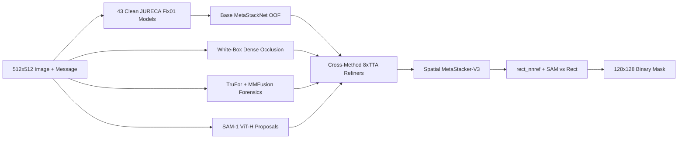

# European AI Championship Paris 2026 — Team WhatThePhoques

Official competition repository for team **WhatThePhoques** (21–22 November 2026, Paris), consolidating all code, experimental analyses, training pipelines, and reproduction artifacts across the three competition tracks:

1. **Task 1 — Image Watermark Localization** (`34-watermark-localisation-image`)
2. **Task 2 — Model Equality Testing** (`33-model-equality`)
3. **Task 3 — Machine Unlearning** (`unlearning`)

All training, model selection, and post-processing pipelines enforce strict zero-leakage evaluation discipline (no test-cover leakage, no holdout hyperparameter tuning, and no external labeled supervision where prohibited).

---

## Results Summary

| Track | Best Public Score | Final Artifact / Submission | Primary Compute | Key Methodological Drivers |
| --- | ---: | --- | --- | --- |
| **Task 1: Watermark Localization** | **0.7897** | `sub_v18_dino_ms.pt` (Sub `#4256`) | JURECA (4xA100) + Modal (A100/H100) | `[0,1]` norm fix, 43 clean OOF models, `TruFor` + `MMFusion` forensics, white-box dense occlusion maps, 4-stage `DINOv2-Large` + `CLIP ConvNeXt-Large` 8xTTA refiners, `SAM-1 ViT-H` + `Axis-Rect` arbitration |
| **Task 2: Model Equality Testing** | **0.10** | `task2/checkpoint/submission.csv` (33 endpoints, 660 queries) | Local CPU + Competition API | Multi-round stratified prompt battery, format/delimiter & choice-edit statistics (`80.4%` stratified practice pass rate at `MCC > 0.65`), split-half family consensus |
| **Task 3: Machine Unlearning** | **0.3433** | `z10.pt` (Modal volume `euroai-task3`) | Apple MPS + Modal A100 | Blocks 8–11 selective unlearning, 9 capped-class logit suppression, block-8 logit-lens readout distillation, natural-view retain anchoring, weight extrapolation |

---

## Task 1: Image Watermark Localization

**Objective.** Localize pixel-level watermarked regions on 512x512 images across three watermarking schemes (**PixelSeal**, **TrustMark**, **StegaStamp**) under four manipulation regimes (object removal, object addition/alteration, object transplantation, and outpainting). Evaluation is per-image symmetric mean IoU (`miou_image`) on a 128x128 grid.

### System Architecture



### Public Leaderboard Progression (100% Clean Zero-Leakage Pipeline)

| Submission ID | Pipeline Milestone | Clean DEV OOF (408) | Untouched Holdout (102) | Public LB | Delta |
| ---: | --- | ---: | ---: | ---: | ---: |
| `1546` | Clean `synth3` multi-model baseline | — | 0.7362 | 0.7362 | — |
| `2261` | `V5.2` + `MetaStackNet` + `rect_nnref` white-box box refinement | 0.7635 | 0.7605 | 0.7634 | +0.0272 |
| `3751` | `V11-Fix01` (`[-1,+1] -> [0,+1]` norm fix) + L/S split-threshold + hole-dip recovery | 0.7676 | 0.7717 | 0.7710 | +0.0076 |
| `3821` | `V6` `SAM-1 ViT-H` semantic snapping + rectangularity guard + soft `b2` L-hole blend | 0.7866 | 0.7815 | 0.7868 | +0.0158 |
| **`4256`** | **`V18` 43 clean models + 4 full-res `DINOv2-L`/`CLIP-L` 8xTTA refiners + `TruFor`/`MMFusion`/`DenseOcc` + `Spatial MetaStacker-V3` + `SAM vs Rect` arbitration** | **0.7943** | **0.7871** | **0.7897** | **+0.0029** |

### Per-Method Final Breakdown (`sub_v18_dino_ms.pt`, Sub `#4256`)

| Watermark Method | DEV OOF (L / S) | Untouched Holdout (L / S) | Key Contributors |
| --- | --- | --- | --- |
| **PixelSeal** | **0.7193** (0.7102 / 0.7285) | **0.7148** (0.6830 / 0.7466) | `V7.2-Fix01`, `ConvNeXt-HP6 Fix01` (`0.6811`), `EVA02-448 Fix01` (`0.6789`), `v17_dinov2l_ms_apex518` (`0.7178` neural hold), `DenseOcc`, `rect_nnref`, `SAM-1 ViT-H` |
| **TrustMark** | **0.7628** (0.6895 / 0.8360) | **0.7342** (0.6800 / 0.7884) | `V11-Fix01` (`+0.0457` over broken norm), `Swin-384 Fix01` (`0.6811` dev), `ConvNeXt dec=256 Fix01` (`0.6806` hold), `v16_cnxl_occ512`, `v17_dinov2l_ms_apex518`, `rect_nnref` (`29/34` S-rect), `SAM-1 ViT-H` |
| **StegaStamp** | **0.9008** (0.8890 / 0.9125) | **0.9122** (0.8726 / 0.9517) | PyTorch-ported official decoder + `ExtAttrSegNet`, `V11-Fix01` (`0.8711` dev), `v15_cnxl_clip512`, `v17_dinov2l_ms_apex518`, `SAM-1 ViT-H` + `RECT_SNAP` (`S 0.9517`) |
| **3-Method Mean** | **0.7943** | **0.7871** | **Public LB: 0.7897** (dev-to-public gap `0.0046`, zero overfitting) |

### Key Technical Findings

- **Input Normalization Fix (`[-1, +1]` to `[0, +1]`)**: Earlier `V5–V10` models passed `[-1, +1]` tensors into ImageNet-normalized visual backbones and Meta's PixelSeal preprocessor. Fixing this single bug raised `TrustMark` single-model 4-fold OOF by `+0.0457` (`0.6451 -> 0.6908`).
- **Pretrained Forensic + White-Box Multi-Modal Conditioning**: Combining zero-shot **TruFor** (CVPR 2023: anomaly map, confidence, `Noiseprint++`), **MMFusion-IML** (MMM 2024: SRM + BayarConv + `Noiseprint++`), and dual-scale (`12x12` + `8x8`) **white-box decoder dense patch occlusion maps** directly exposes inpainted `L`-holes where pure watermark SNR saturates.
- **Cross-Method Full-Resolution Refiners with 8x Dihedral TTA**: All three watermark methods share the same four image-editing pipelines. Jointly training 4-stage multi-scale **Meta DINOv2-Large (`518x518`)** and **CLIP LAION-2B ConvNeXt-Large (`512x512`)** over the 408 clean `dev` images with synchronized image/logit dihedral flips and rotations yielded `+0.015` to `+0.033` neural OOF gains without holdout leakage.
- **Geometry-Aware Post-Processing**: All thresholds and triggers are selected exclusively via 4-fold nested DEV CV: white-box `rect_nnref` crop decoding locks high-confidence rectangles, while joint `SAM-1 ViT-H` vs. `Axis-Rect` arbitration (`RECT_SNAP`) snaps semantic objects cleanly without overwriting rectangular patches.

---

## Task 2: Model Equality Testing

**Objective.** Partition 33 anonymous LLM endpoints into `(family, model)` identities under a strict query budget. Evaluation weights family clustering at 10% and within-family model identity at 90% (Matthews Correlation Coefficient). Watermarks, system prompts, and decoding hyperparameters preserve model identity, whereas quantization or LoRA fine-tuning alter identity.

### Methodology and Offline Validation

- **Prompt Battery & Caching (`task2/`)**: 30 curated prompts spanning 5 domains (math, coding, language, domain knowledge, logic), split into 20 development and 10 held-out prompts. Formal submissions (`660` total queries = `33 endpoints x 20 prompts`) and practice caches (`9 endpoints x 30 prompts x 3 repeats`) are archived under `task2/checkpoint/` and `task2/test-data/`.
- **Two-Stage Family + Within-Family Variant Partitioning**:
  - Stage 1 assigns coarse families (`G1`, `G2`, `G3`) via diagnostic structural probes (`task2/checkpoint/families.csv`).
  - Stage 2 (`task2/variant_rank.py` and `task2/choice_edit.py`) scores per-prompt structural, formatting, delimiter-change, and option-restatement deviations across endpoints within each family, then partitions core vs. variant clusters.
  - Adding `choice_edit` delimiter/restatement signals increased 2048-trial stratified offline pass rate (`model MCC > 0.65`) from **75.1%–75.5%** to **79.9%–80.4%** across three independent seeds (`519883`, `731029`, `7241831`), and raised fixed-hard pass rate from **40.6%–43.0%** to **52.8%–54.5%**.
- **2-Shot Persona Suppression (`task2_sync/hermes_open2shot.py`)**: Demonstrated that prepending two concise `user`/`assistant` exemplars suppresses verbose system-prompt wrappers without modifying the `system` role.

### Reproduction

```bash
python3 -m venv .venv && source .venv/bin/activate
pip install -r task2/requirements.txt

# Reproduce formal submission CSV from cached 660 formal responses
python task2/variant_rank.py \
  --answers task2/checkpoint/formal.jsonl \
  --families task2/checkpoint/families.csv \
  --out task2/runs/reproduced.csv
cmp task2/runs/reproduced.csv task2/checkpoint/submission.csv

# Run offline 2048-trial practice verification
python task2/replay.py --solver choice_edit --seed 7241831
python task2/replay.py --solver choice_edit --seed 7241831 --protocol fixed-hard
```

---

## Task 3: Machine Unlearning

**Objective.** Given only a trained 100-class ViT checkpoint (`model.pt`) and an unlabeled 3,500-image forget set (`forget_images.npz`), produce an unlearned checkpoint matching the output distribution of a model retrained without the forget set—without access to labels, a retain set, or external data—while keeping validation accuracy above the 70% hard gate.

### Key Empirical Findings & Pipeline (`task3/`, `task3_claude/`, `task3_sync/`)

1. **Structural Diagnosis of the Forget Set**:
   - Nine classes contain exactly 130 images each (capped classes). Empirical score probing (`34` scored submissions in `task3/submissions.jsonl`) showed the retrained gold model misclassifies these 9 classes heavily (cross-entropy ~10–12) while concentrating probability mass on the original model's runner-up classes—including other capped classes in the same visual family. Zeroing out capped classes in targets caused sharp score drops.
   - For the remaining 36 classes present in the forget set, pushing the memorized class slightly below the runner-up class outperformed preserving it.
2. **Selective Late-Layer Unlearning & Retain Anchoring (`task3/xh_*.py`)**:
   - **Frozen backbone prefix**: Freeze ViT blocks `0–7`; fine-tune only blocks `8–11`, `norm`, and `head` to preserve general feature representations and stay well above the 70% retain accuracy gate.
   - **Composite target construction (`xh_target3.py`, `xh_target5.py`, `xh_target6.py`, `xh_target7.py`)**: Combines capped-class margin suppression (`-10` below best non-memorized class), scaled block-8 logit-lens readouts (`2.5x`), per-class forget-count stratification, and natural-view retain anchors.
   - **5-Fold Layer-Reinitialization Gold Stand-In (`task3_claude/modal_app.py`)**: Re-initializing blocks `7–11` and training 5-fold cross-fit models yielded an offline stand-in correlating at **r = 0.996** with public scores across 8 calibrated checkpoints.
   - **Final Deliverable**: `z10.pt` achieved **0.3433** on the public leaderboard (`327.7 MB` float32 `state_dict`, `strict=True` verified, zero NaN/Inf, SHA-256 `7e047d8af8d65dce812df958b0db11bea73c7bd499befffb87212f192b06c665`, archived on Modal volume `euroai-task3:/xh/runs/z10.pt`).

### Reproduction

```bash
cd task3
uv venv .venv --python 3.12
uv pip install --python .venv/bin/python -r requirements.txt
.venv/bin/python -c "from huggingface_hub import snapshot_download; snapshot_download('SprintML/unlearning', repo_type='dataset', local_dir='starter')"

# Stage 1-4: diagnostics, block-7 token cache, OOF readouts, and target generation
PYTORCH_ENABLE_MPS_FALLBACK=1 .venv/bin/python xh_diag.py
PYTORCH_ENABLE_MPS_FALLBACK=1 .venv/bin/python xh_tokens.py
PYTORCH_ENABLE_MPS_FALLBACK=1 .venv/bin/python xh_oof.py
PYTORCH_ENABLE_MPS_FALLBACK=1 .venv/bin/python xh_target3.py t_mixed 10 2.5
PYTORCH_ENABLE_MPS_FALLBACK=1 .venv/bin/python xh_target5.py t_grad4 4 1.0
```

---

## Repository Structure

```text
euro-ai-championship-paris/
├── README.md                          # Unified competition overview and results
├── docs/                              # Official problem PDFs, briefs, and technical analyses
│   └── tasks/                         # Per-task specifications, experiment logs, and paper rankings
├── src/
│   ├── task1_stegastamp/              # PyTorch StegaStamp extractor port and StegaExtSegNet
│   ├── task1_v2_v4/                   # V2-V4 clean synth3 K-fold trainers and pure-dev OOF fusion
│   ├── task1_v5_v8/                   # V5.2-V8 DualConvNeXt, RectSearch-V2, NNRef, MetaStackNet
│   └── task1_v11_v18/                 # Final 0.7897 sprint: JURECA Fix01 + Modal SAM/TruFor/DINOv2-L/V18
├── task1/                             # Collaborative Task 1 exploration, crop search, and handoffs
├── task2/                             # Task 2 prompt battery, replay harness, solvers, and receipts
├── task2_sync/                        # 2-shot exemplar persona-suppression probes and caches
├── task3/                             # Final Task 3 unlearning pipeline (z10, 0.3433 LB) and logs
├── task3_claude/                      # 5-fold k=7/world gold stand-in calibration and literature map
├── task3_sync/                        # Task 3 mini-gold benchmark and coordination notes
└── reports/                           # Literature survey on invisible watermark localization
```

---

## Contributors

Built by team **WhatThePhoques** at the European AI Championship Paris (November 2026):
- **Simon Qin** (`sinonchum`)
- **Wenhan Ding** (`wenhanding`)
- **Xuanhao** (`xuanhao`)
- **Chuan Li** (`li103`)

## License & Data Governance

Competition datasets, pretrained watermarkers, and evaluation checkpoints remain subject to the official European AI Championship Paris 2026 terms. No API keys, cluster credentials, or personal tokens are stored in this repository.
